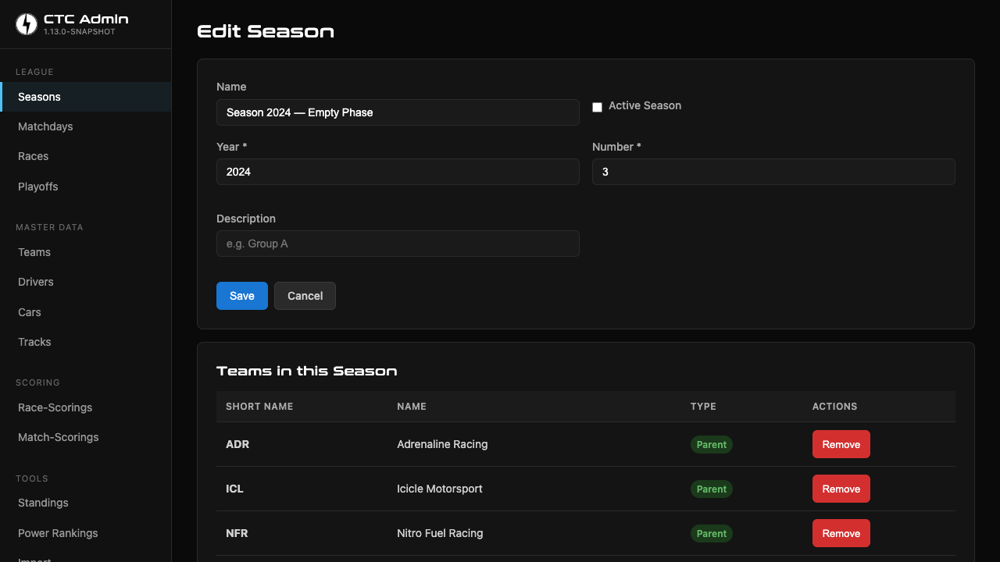
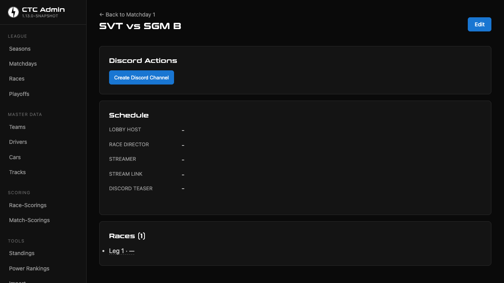
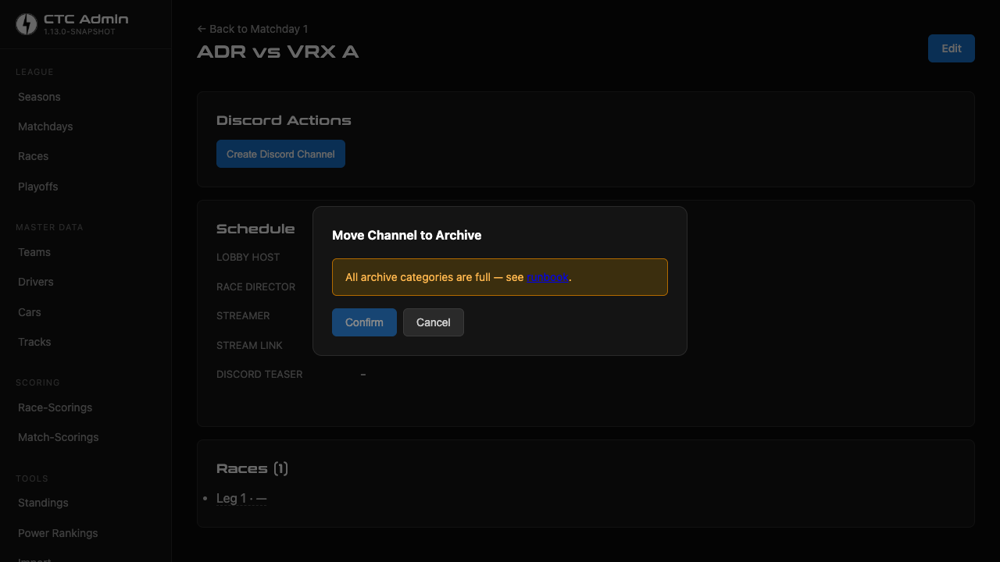
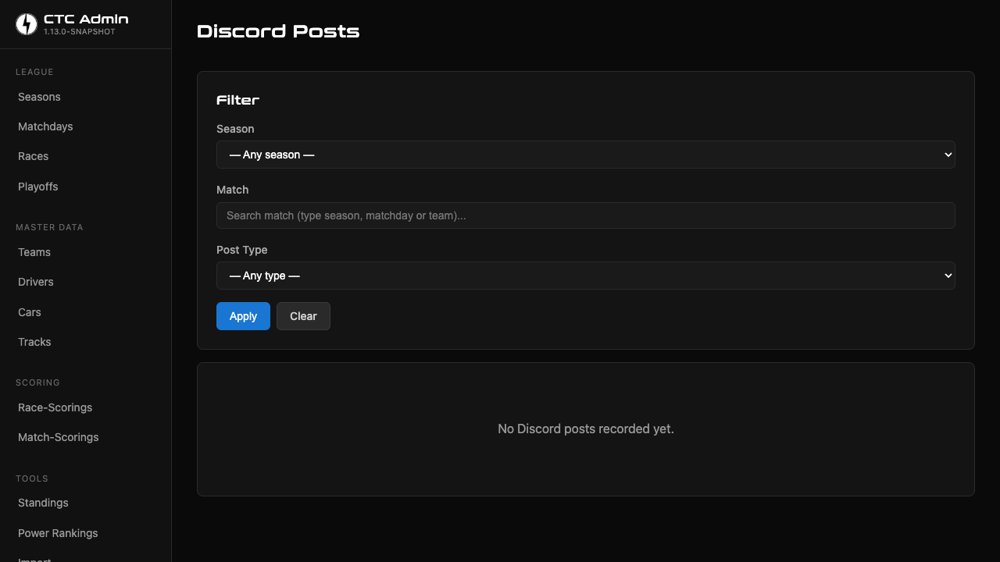

# CTC Manager — Discord Integration Runbook

Audience: operator (league admin) configuring the Discord integration —
bot registration, OAuth2 invite, env-var wiring, admin-config page,
the 4 user-visible error categories surfaced by the admin UI, the
UAT-03 live-smoke procedure, and recurring troubleshooting scenarios.

**Cross-references:**

- Config keys in `application-{dev,local,docker,prod}.yml` and `application.yml`: `app.discord.bot-token`, `app.discord.allowed-hosts`, `app.discord.base-url`, `app.discord.connect-timeout`, `app.discord.read-timeout`, `app.discord.rate-limit.*`, `app.timezone`
- Env-var contract: `DISCORD_BOT_TOKEN` (never written into YAML literals)
- Java surface: [`DiscordRestClient.java`](../../src/main/java/org/ctc/discord/DiscordRestClient.java), [`DiscordWebhookClient.java`](../../src/main/java/org/ctc/discord/DiscordWebhookClient.java), [`DiscordHostValidator.java`](../../src/main/java/org/ctc/discord/DiscordHostValidator.java), [`DiscordConfigController.java`](../../src/main/java/org/ctc/discord/web/DiscordConfigController.java)
- Exception hierarchy: [`org.ctc.discord.exception.DiscordApiException`](../../src/main/java/org/ctc/discord/exception/DiscordApiException.java) + 4 sealed permits (`DiscordTransientException`, `DiscordAuthException`, `DiscordNotFoundException`, `DiscordCategoryFullException`)
- Threat model: [`93-THREAT-MODEL.md`](../../.planning/phases/93-discord-foundation/93-THREAT-MODEL.md)
- Related operator runbooks: [google-integration.md](google-integration.md), [release-runbook.md](release-runbook.md)

---

## 1. Setup — Bot Registration

One-time operator action per deployment environment. The dev/local profiles can
share a single test-bot; production should use a dedicated bot with no access
to your test guild.

### 1.1. Create the Discord Application + Bot

1. Open the [Discord Developer Portal](https://discord.com/developers/applications).
2. Click **New Application** → name it (e.g. `CTC Manager (test)` for dev/local,
   `CTC Manager` for production) → **Create**.
3. In the left sidebar, click **Bot**. The bot user is auto-created — no extra
   "Add Bot" click needed in current portal versions.
4. Optional: under **Bot → Username / Avatar**, give the bot a recognizable name
   and icon. These are what your match-channel webhooks will display.

### 1.2. Reveal the Bot Token

1. Still on the **Bot** tab, scroll to the **Token** section.
2. Click **Reset Token** → confirm. Discord shows the token **exactly once** —
   copy it immediately into a password manager.
3. The token format is `<base64-segment>.<timestamp>.<hmac>` (e.g.
   `MTI0NjU…YWJj.GhPp1U.Z1xX…`). If you lose it, click **Reset Token** again to
   issue a new one; the previous token is invalidated immediately.

**Privileged Gateway Intents:** leave **all three** OFF (Presence Intent, Server
Members Intent, Message Content Intent). Publishing uses REST. The optional private-picks
consumer uses an outgoing Gateway connection without privileged intents and obtains current
authorization facts through REST.

### 1.3. Bot Permissions — OAuth2 URL Generator

In the Developer Portal, click **OAuth2 → URL Generator**.

**Scopes:**

- `bot`
- `applications.commands` for the explicitly registered `/picks` and `/incidents` workflows. Discord includes this scope by default with `bot`.

Command registration and the outgoing Gateway connection are separate, explicit setup steps.

**Bot permissions** for the current integration:

| Permission | Purpose |
|------------|---------|
| View Channels | Required for every REST call against a guild |
| Manage Channels | Create per-match channels + archive |
| Manage Roles | Grant configured stewards missing access on the incident match channel after cutoff; required only when a grant is necessary |
| Manage Webhooks | Create the per-channel webhook in a new match channel |
| Send Messages | Bot-direct posts (when not using a webhook) |
| Embed Links | Embed previews in match-channel posts |
| Attach Files | Team Cards, Settings, Lineups, race-result graphics |
| Read Message History | Edit-path — locate existing `discord_post` row |
| Manage Messages | Edit-path — patch existing webhook messages |
| Pin Messages | Pin stage posts in the match channel |
| Create Public Threads | Race-result + standings forum threads |
| Send Messages in Threads | Post into forum threads |
| Manage Threads | Auto-unarchive of forum threads (`MANAGE_THREADS`) |

**Explicitly NOT recommended:**

- ❌ `Administrator` — over-privileged; bypasses the post-create permission audit
- ❌ `Create Private Threads` — race-result forum threads are public by design
- ❌ `Kick Members` / `Ban Members` / `Manage Server` — outside the integration; incident access uses channel overwrites and does not assign guild roles
- ❌ All Voice permissions — bot posts in text channels only
- ❌ `Mention Everyone` — match-channel posts do not @everyone
- ❌ `Use External Emojis` — emoji resolution uses only the configured guild's custom emojis (via `DiscordEmojiCache`)

The URL Generator concatenates the bot permission bitmask into the generated
URL — copy that URL and open it in a browser to invite the bot.

### 1.4. Invite the Bot into a Guild

1. Open the generated OAuth2 URL in a browser where you're logged in as the
   guild owner.
2. **Add Bot To**: select your test guild (dev/local) or production guild.
   You need at least **Manage Server** permission in the target guild to
   complete the OAuth flow.
3. Confirm the permissions screen → **Authorize**.
4. Solve the CAPTCHA if shown.

The bot now appears in the guild's member list (offline, because we use REST
only). Verify by opening the guild in your Discord client — the bot is in the
member list with the role auto-created by Discord during the OAuth flow (named
after the application).

### 1.5. Wire the Token into the JVM Process

The bot token is read from the `DISCORD_BOT_TOKEN` environment variable. It
MUST never be written into a YAML literal (T-93-01 mitigation surface a).

**Local startup via `scripts/app.sh`** (recommended — the canonical entry point):

`scripts/app.sh` auto-loads two files from the project root before launching
the Spring Boot JVM:

1. `.env` — base, always loaded if present.
2. `.env.<primary-profile>` — profile-specific override. Primary profile is the
   first segment of the `--profiles` value (`dev,demo` → `.env.dev`).

So you simply add the token to whichever file matches the profile you intend
to use. Put it in `.env` (base) if you want it for **every** profile, in
`.env.dev` if it should apply only when starting `dev`/`dev,demo`, in
`.env.local` only for the `local`/MariaDB profile.

```bash
# .env.dev (example)
DISCORD_BOT_TOKEN=<the-token-you-copied>
```

Then:

```bash
./scripts/app.sh start dev          # H2 in-memory, port 9090 — recommended for UAT-03
# or
./scripts/app.sh start local        # real MariaDB on port 3307, app on 9091
./scripts/app.sh stop               # graceful shutdown
./scripts/app.sh status             # check PID
```

If the env-var is absent at JVM-start, the bot-token defaults to empty string
and all 4 admin-page test buttons return a `DiscordAuthException` flash badge
with the message `"Authentication failed. Verify DISCORD_BOT_TOKEN is set in
the environment."`.

**Manual startup without the wrapper script** (if you don't want `scripts/app.sh`):

```bash
set -a; source .env.dev; set +a
./mvnw spring-boot:run -Dspring-boot.run.profiles=dev
```

`set -a` makes every subsequent assignment auto-exported; `source` reads the
file as Bash; `set +a` turns it back off.

**Docker** (`docker` profile):

`docker-compose.yml` does not read `.env` files into the container — pass the
token explicitly via the `app` service's `environment:` block:

```yaml
services:
  app:
    environment:
      SPRING_PROFILES_ACTIVE: docker
      DISCORD_BOT_TOKEN: ${DISCORD_BOT_TOKEN}
      # ...
```

The `${DISCORD_BOT_TOKEN}` reference in the compose file is interpolated from
your shell (or from a `.env` next to `docker-compose.yml`, which Compose reads
**only** for interpolation, not as container env-vars).

**Production** (`prod` profile):

Set `DISCORD_BOT_TOKEN` as a process-level env-var on the host (systemd unit
`Environment=`, Kubernetes Secret + `envFrom`, or whatever your deployment
tooling uses). Do not write the token into any file checked into git, including
`.env.prod` examples.

### 1.6. Enable Discord Developer Mode (one-time, per device)

To copy guild/channel/role IDs (snowflakes) you need Developer Mode in your
Discord client. This is a per-device setting on your operator workstation, not
a server-side configuration.

**Desktop / Web (`discord.com`):**

1. Click the **gear icon** next to your avatar (bottom-left) to open **User
   Settings**.
2. Left sidebar → **App Settings** group → **Advanced**.
3. Toggle **Developer Mode** **ON**.
4. Close settings (Esc or top-right ✕).

**Mobile:**

1. Tap your avatar (bottom-right) → **Settings**.
2. **App Settings → Behavior** → toggle **Developer Mode** ON.

After enabling, right-click context menus (desktop) and long-press menus
(mobile) show a **Copy ID** / **Copy Server ID** / **Copy Channel ID** entry.

### 1.7. Copy the Guild ID (Server Snowflake)

**Desktop / Web:**

1. In the **server list** on the very left edge of the Discord client, **right-click
   the icon of your test guild**.
2. Scroll the context menu to the bottom → **Copy Server ID**.

The clipboard now contains a 17–20 digit number, e.g. `1234567890123456789`.

**Mobile:**

Long-press the server icon → **Copy Server ID**.

**Verify the ID is a valid snowflake:**

- Only digits, no letters or dashes
- 17–20 characters long (the CTC form-validation `@Pattern` is `^\d{17,20}$|^$`)
- Modern guilds are typically 18–19 digits; legacy guilds may have 17

**Sanity check:** open `https://discord.com/channels/<your-guild-id>` in your
browser. If the guild loads, the ID is correct. (A channel-ID would land you on
`…/channels/@me` or 404.)

### 1.8. Webhook URL (for the `Test Announcement-Webhook` button)

Create a webhook in your test guild's announcement channel:

1. In Discord, right-click the channel → **Edit Channel** → **Integrations** →
   **Webhooks** → **New Webhook**.
2. Name it e.g. `CTC Manager (test)` → optional avatar → **Save Changes**.
3. Click **Copy Webhook URL**.

The URL is `https://discord.com/api/webhooks/<id>/<token>` and must match the
`@Pattern` regex on `DiscordConfigForm.announcementWebhookUrl`:
`^https://discord\.com/api/webhooks/\d+/[\w-]+$|^$`.

Production deployments will instead use the webhook auto-created in each match
channel — the configured `announcementWebhookUrl` is only the **league-wide**
announcement channel (e.g. matchday previews + standings).

### 1.9. Forum-Channel + Thread Setup

Two forum channels publish league-wide season content:

- **Race-Results Forum** — one thread per season; every race-result graphic is
  posted into that thread (and auto-unarchives if Discord archived it).
- **Standings Forum** — one thread per season; every per-phase standings post
  (with `MANAGE_THREADS` for auto-unarchive) lands here.

**Bot prerequisite:** the bot role needs `MANAGE_THREADS` in both forum
channels (already part of the OAuth bitmask above; verify the override is not
removed at channel-level).

**Per forum, set up the webhook + first thread:**

1. In Discord, pick the target category → **Create Channel** → choose
   **Forum** → name it `race-results` (or `standings`) → **Create Channel**.
2. Open the forum channel → **Edit Channel** → **Integrations** →
   **Webhooks** → **New Webhook** → name it `CTC Manager (race-results)` (or
   `standings`) → **Copy Webhook URL**.
3. Open `/admin/discord-config` and paste the URL into
   **Race-Results Forum Webhook URL** (or **Standings Forum Webhook URL**).
4. Back in the forum channel: click **New Post** → set the post title
   (e.g. `Saison 4 – 2026` for race-results, `2026` for standings) → publish.
5. With Developer Mode enabled (§ 1.6), right-click the new post in the
   sidebar → **Copy Thread ID**.
6. Open `/admin/seasons/{id}/edit` → **Discord Integration** card →
   **Link existing Thread…** → paste the Thread ID → **Save**.



The Thread ID lands on `seasons.discord_race_results_thread_id` or
`seasons.discord_standings_thread_id` (Flyway V12). Every forum post then
attaches `?thread_id=<id>` so Discord routes it into the same thread.

---

## 2. Admin Configuration Page

URL: `/admin/discord-config`.

### 2.1. Six Form Fields

| Field | Purpose | Validation |
|-------|---------|------------|
| **Guild ID** | Discord server snowflake | snowflake or empty |
| **Bot Application ID** | snowflake of the application (Developer Portal → General Information → Application ID) — used for permission audits | snowflake or empty |
| **Announcement Webhook URL** | League-wide announcement webhook (matchday previews + standings) | `https://discord.com/api/webhooks/…` or empty |
| **Race-Results Forum Channel ID** | Snowflake of the forum channel where race-result threads land | snowflake or empty |
| **Standings Forum Channel ID** | Snowflake of the forum channel for season-standings threads | snowflake or empty |
| **VS Emoji Name** | Short-name of the custom guild emoji used between team names in match previews (e.g. `CTC`, `VS`, `vs`) — resolved at post-time via `DiscordEmojiCache` | `@NotBlank @Size(max=50)`, defaults to `CTC` |

Empty fields show a small `.badge-warning` "not configured" badge so the
operator sees at a glance what is left to fill in.

### 2.2. Four Test/Refresh Buttons

Each button issues exactly one REST call to Discord. Buttons are disabled
when their prerequisite field is empty.

| Button | Endpoint | Prerequisite | Success-badge text |
|--------|----------|--------------|--------------------|
| **Test Connection** | `GET /users/@me` (bot itself) | `DISCORD_BOT_TOKEN` env-var | `Connected as <username>` |
| **Test Announcement-Webhook** | `POST <webhook-url>` (1 line test message) | `announcementWebhookUrl` non-empty | `Webhook test posted to <channel-name>` |
| **Refresh Server-Roles Cache** | `GET /guilds/{guildId}/roles` | `guildId` non-empty | `Server roles refreshed (N entries).` |
| **Refresh Emoji Cache** | `GET /guilds/{guildId}/emojis` | `guildId` non-empty | `Emoji cache refreshed (N entries).` |

All buttons share the same typed-exception → flash-badge wiring described in
section 3.

### 2.3. Daily Operations

Eleven structured post types cover the full league lifecycle. Buttons live on
the relevant admin page; every button has a pre-flight gate that disables it
until prerequisites are met (with a tooltip listing the missing fields).

**Match-Channel lifecycle** (`/admin/matches/{id}`):



1. **Create Discord Channel** — creates a per-match channel under the
   configured "Current Match Category", auto-creates the channel webhook,
   runs the permission audit, and stores `matches.discord_channel_id`.
   Pre-flight: both teams have `discord_role_id` set. A repeated or concurrent
   click on a match that already has a channel creates nothing.
2. **Post Team Cards** — multipart POST with 2 PNGs (per-team rosters).
3. **Post Settings** — multipart POST with N PNGs (one per race-setting
   sheet).
4. **Post Lineups** — multipart POST with N PNGs (one per race lineup).
5. **Post Schedule** — JSON POST with Discord embed (`Date <t:N:F>`,
   `Lobby Host`, `Race Director`, `Streamer`, `Stream Link`). Pre-flight:
   `lobbyHost`, `raceDirector`, `streamer` set. Auto-edits the existing
   embed when any of those fields change.
6. **Post Provisional Scores** — multipart POST with N PNGs (intermediate
   results between races). Auto-edits when results change.
7. **Post Match Results** — multipart POST with `match-results.png`.
   Pre-flight: `allMatchesFinal == true`. Stale-detection turns the button
   **yellow** ("Update Match Results") if any race result changed after
   the last post.
8. **Move to Archive** — opens a modal listing year-categories (regex
   `Match Days Archive {year} ({num})`). Each category is capped at 50
   channels per Discord; if full, the operator picks another or creates a
   new category in Discord and re-opens the modal.



**Matchday-level posts** (`/admin/matchdays/{id}`):

9. **Match Preview Announcement** (POST-06) — embed posted into the
   announcement webhook. Pre-flight: `announcementWebhookUrl` configured,
   `streamLink` and `discordTeaser` set. Auto-edits when `streamLink` or
   `discordTeaser` change post-creation.
10. **Match Day Results** (POST-07a) + **Power Rankings** (POST-07b) —
    multipart POSTs into the race-results forum thread after the matchday is
    finalized. Stale-detection re-renders graphics if upstream scores change.
11. **Post Matchday Pairings** (POST-09) — hybrid Markdown + PNG into the
    announcement webhook. Markdown body uses the operator-editable template
    on `/admin/discord-config` (placeholders `{{matchdayNumber}}`,
    `{{deadline}}`, `{{weekend}}`, `{{ctcEmoji}}`); PNG attachment generated
    by `MatchdayPairingsGraphicService`. Pre-flight gates on
    `announcementWebhookConfigured` AND `pickDeadlineSet` AND
    `scheduledWeekendSet` AND `allTeamsAssigned`. Set `pickDeadline` +
    `scheduledWeekend` via the **Edit Pairings** form on the matchday
    detail page. Stale-detection turns the button yellow ("Update Matchday
    Pairings") when `matchday.updatedAt > post.updatedAt` — operator clicks
    Update to PATCH the existing post.
12. **Post Matchday Schedule** (POST-10) — pure-multipart PNG (no
    Markdown, no embed) into the announcement webhook. Generated by
    `MatchdayScheduleGraphicService`. Pre-flight gates on
    `announcementWebhookConfigured` AND every match's first `Race.dateTime`
    set. Stale-detection turns the button yellow ("Update Matchday
    Schedule") when MAX(`match.updatedAt`, `race.updatedAt`) >
    `post.updatedAt`. NO AFTER_COMMIT hook (PNG re-render
    Playwright-expensive — operator-driven by design).

**Season-level posts** (`/admin/seasons/{id}`):

11. **Standings** (POST-08) — per-phase, multipart into the standings
    forum thread. For phases with `GROUPS` format, a multipart payload
    splits across up to 8 attachments.

**Forum-thread posts:**

- **Race Result** (FORUM-02) — per race, posted into the linked race-results
  thread; auto-unarchives the thread if Discord archived it (requires
  `MANAGE_THREADS`).

**Listing + audit:** all posts are visible at `/admin/discord/posts` with
filters by post type, channel, and timestamp. Use this page to confirm a
post landed, to inspect attachment counts, or to spot stale entries.



---

## 3. Error Categories

The admin page renders one of 4 BEM-styled badges (`.error-badge--<category>`)
on every test/refresh failure, mapped from the sealed `DiscordApiException`
hierarchy:

| Category | Sealed Permit | User-Visible Message | Typical HTTP Status | Operator Action |
|----------|---------------|---------------------|---------------------|-----------------|
| `auth` | `DiscordAuthException` | `Authentication failed. Verify DISCORD_BOT_TOKEN is set in the environment.` | 401, 403 (token-related) | Re-check env-var; reset token in Developer Portal if compromised. |
| `transient` | `DiscordTransientException` | `Discord is temporarily unavailable. Please retry.` | 5xx after retry exhaustion, or network failure | Wait 30s and retry. If repeating, check [Discord Status](https://discordstatus.com). |
| `not-found` | `DiscordNotFoundException` | `Discord resource not found. Verify the configured ID is correct.` | 404 | Re-verify the snowflake; confirm bot is a member of the guild. |
| `category-full` | `DiscordCategoryFullException` | `Discord category is full (50/50 channels). Create a new archive category and retry.` | 400 with body `{"code": 30013}` | Only surfaces from the match-channel archive flow — not from the discord-config test buttons. |

The mapper deliberately never echoes `e.getMessage()` from the underlying
RestClient exception — that would risk leaking the bot token in a stacktrace
fragment (T-91-02-IL invariant + T-93-01 mitigation surface c').

---

## 4. UAT-03 — Live-Discord Smoke (post-deploy)

This is the operator-bound UAT-03 from `STATE.md` "Pending UATs". It MUST run
before the match-channel-lifecycle work begins, because WireMock fixtures cannot prove the
actual Discord-API contract.

**Prerequisites** (all from section 1):

- [ ] Bot application created in Developer Portal
- [ ] Bot token copied into a password manager
- [ ] Bot invited into a test guild via OAuth2 URL with the recommended permission set
- [ ] `DISCORD_BOT_TOKEN=…` line present in `.env` (any profile) or `.env.dev` (dev-only)
- [ ] Developer Mode enabled in your Discord client
- [ ] Guild ID copied
- [ ] (Optional) Webhook URL copied for the test-webhook button

**Procedure:**

1. Start the app via the wrapper script — `dev` profile is sufficient (H2 in-memory,
   no MariaDB setup required, the Discord HTTP calls still go to the real
   `https://discord.com/api/v10`):
   ```bash
   ./scripts/app.sh start dev
   ```
   (use `start local` if you want to exercise the MariaDB path too; the test
   buttons themselves don't care which DB backs the singleton config row.)
2. Browse to `http://localhost:9090/admin/discord-config` (or `:9091` for `local`).
3. Fill **Guild ID** with the test-guild snowflake; click **Save**.
   → expect green `.alert-success` "Configuration saved."
4. Click **Test Connection**.
   → expect `Connected as <bot-username>` matching the name you set in Developer Portal § 1.1.
5. (Optional) Paste your test-webhook URL into **Announcement Webhook URL**,
   click **Save**, then click **Test Announcement-Webhook**.
   → expect a test message in the configured Discord channel + a success badge in the UI.
6. Click **Refresh Server-Roles Cache**.
   → expect `Server roles refreshed (N entries).` matching the role count in
   your test guild (Discord shows them in Server Settings → Roles).
7. Click **Refresh Emoji Cache**.
   → expect `Emoji cache refreshed (N entries).` matching the custom-emoji
   count in your test guild (Server Settings → Emoji).
8. Capture Desktop **and** Mobile (375×667) screenshots per
   [[feedback_playwright_cli]] and link them in the STATE.md UAT-03 entry.

**Pass criteria:** all 4 buttons return a success badge; the role + emoji
counts match the guild's actual state; no stacktrace appears in the log
(Logback `%replace` mask would mask any leaked webhook URL anyway, but bot
tokens leaving the JVM should not happen at all).

---

## 5. Troubleshooting

### `Copy ID` / `Copy Server ID` menu entry missing

- Developer Mode is off — go back to section 1.6 and toggle it ON.
- Discord client open since before the toggle — restart the Discord client.

### "Test Connection" returns `auth` badge

- `DISCORD_BOT_TOKEN` not present in the `.env` file matching the active
  profile (`scripts/app.sh start dev` reads `.env` + `.env.dev`; `start local`
  reads `.env` + `.env.local`). Add the line and restart the app.
- Token was reset in the Developer Portal after you copied it — issue a new
  reset and update the `.env` file.
- Token has surrounding quotes in the `.env` file — `set -a; source` keeps
  quotes literal, which makes the resulting env-var value start with `"`. Write
  the line as `DISCORD_BOT_TOKEN=<token>` without quotes (bot tokens contain
  only `[A-Za-z0-9._-]`, no characters that require quoting).
- Manual startup (`./mvnw spring-boot:run` directly) without sourcing the
  `.env` file first — either use `./scripts/app.sh start dev`, or
  `set -a; source .env.dev; set +a` immediately before the `mvnw` call in the
  **same** shell session.

### "Test Connection" returns `not-found` badge

- The token is valid but the bot was kicked from the guild. Re-invite via the
  OAuth2 URL.

### "Refresh Server-Roles" returns `not-found`

- The configured Guild ID is wrong — verify by opening
  `https://discord.com/channels/<guild-id>` in a browser.
- The bot is not a member of that guild — re-invite via the OAuth2 URL.

### "Refresh Server-Roles" returns 0 entries despite the guild having roles

- The bot's auto-assigned role does not include `View Channels` — Server Settings
  → Roles → `CTC Manager` → toggle `View Channels` ON.

### "Test Announcement-Webhook" returns `auth` badge

- The webhook URL is invalid (token segment after the `/` was revoked when the
  channel was edited) — recreate the webhook via Edit Channel → Integrations →
  Webhooks.

### The 4 test buttons are disabled (greyed-out)

- The prerequisite field is empty. Save the form first, then the buttons
  enable on the next page render. The disabled-state is purely server-side
  rendered via Thymeleaf `th:disabled` — no JavaScript involved.

### Log lines contain the literal string `https://***/webhooks/***/***`

- This is expected. The Logback `%replace` mask redacts every webhook URL that
  appears in any log line, with or without `/api` and a `/vN` version
  (T-93-02 mitigation surface c). If you see an
  **unmasked** webhook URL anywhere in the logs, that is a regression — file
  an issue immediately and revert the Logback change.

## 6. Token-Rotation Procedure

The bot token grants full access to every guild the bot is in. Rotate it on a
schedule (e.g. quarterly), immediately on suspicion of leakage, and after any
contributor with token access leaves the project.

**Standard rotation:**

1. In the Discord Developer Portal → your application → **Bot** → click
   **Reset Token**. Discord invalidates the old token immediately and shows
   the new one once — copy it.
2. Update the secret store:
   - **prod / docker:** set `DISCORD_BOT_TOKEN` in the deployment secret
     store (env or `.env` mounted into the container).
   - **dev / local:** update `.env.dev` or `.env.local`.
3. Restart the app — `./scripts/app.sh restart` (or `./scripts/app.sh
   restart dev` for the dev profile).
4. Open `/admin/discord-config` → click **Test Connection** → expect a
   green `Connected as <bot-username>` badge. If the badge is red `auth`,
   re-check the env var and restart again.

**Emergency rotation (token leaked or suspected leak):**

1. Reset the token in the Developer Portal immediately (step 1 above) —
   that revokes the leaked token first, regardless of whether the new one
   reaches the app right away.
2. Update the secret store and restart (steps 2–3 above).
3. Verify with `Test Connection` (step 4).
4. Check the audit trail: `grep -E 'DISCORD' logs/*` for unexpected
   access patterns (unknown channels created, unknown messages posted)
   over the window the leaked token was valid.

## 7. UAT-08 Procedure + Extended Troubleshooting

This is the operator-bound UAT-08 from `STATE.md` "Pending UATs". It MUST
run before `/gsd-complete-milestone v1.13`, because WireMock fixtures
cannot prove the live Discord-API contract for the full post matrix.

**Prerequisites** (all from sections 1 and 2):

- App running in the `dev` profile with the test guild's bot token wired.
- One spare match scheduled in the test guild's category, with both teams
  having `discord_role_id` set and at least one race lineup populated.
- Race-results and standings forum threads linked on the test season
  (see § 1.9).

**Procedure** — 15 stages (9 match-channel + 4 matchday-level + 2
matchday-announcement), each verified by a flash badge in the app and a
visible artifact in the Discord client:

1. `/admin/matches/{id}` → **Create Discord Channel**. Expect green
   `Discord channel created` badge; reload to see the post-action
   buttons; verify the new channel + auto-created webhook in Discord.
2. **Post Team Cards**. Expect 2 PNG attachments in the new channel.
3. **Post Settings**. Expect N PNG attachments (one per race-setting
   sheet).
4. **Post Lineups**. Expect N PNG attachments.
5. **Post Schedule**. Expect a Discord embed with Date / Lobby Host /
   Race Director / Streamer / Stream Link. Edit one of those fields
   in the admin and re-save — the embed updates in place (auto-edit
   PATCH, same `messageId`). All 4 fields render `inline: false`
   (one-per-row layout, Plan 98-04).
6. Submit at least one race result, then **Post Provisional Scores**.
   Expect N PNGs in the channel.
7. After all races are final and `allMatchesFinal == true`, click
   **Post Match Results**. Expect `match-results.png` posted, plus the
   button turning yellow ("Update Match Results") if you tweak a race
   result and re-render.
8. Open the Race-Result forum thread → confirm the race-result graphic
   landed; if Discord archived the thread, confirm the post triggered
   an auto-unarchive.
9. `/admin/matches/{id}` → **Move to Archive** → pick a year-category →
   **Confirm**. Verify the channel moved under that category in Discord.
10. `/admin/matches/{id}` → **Post Match Preview** (POST-06). Expect a
    Markdown announcement on the announcement webhook with H1/H2/H3 +
    teaser + date + stream + emoji line. Edit `streamLink` or
    `discordTeaser` → expect PATCH (same `messageId`, `(edited)` marker).
11. `/admin/matchdays/{id}` → **Post Match Day Results** (POST-07a).
    Expect aggregate matchday PNG in the race-results forum thread.
12. `/admin/matchdays/{id}` → **Post Power Rankings** (POST-07b). Sibling
    button to Stage 11; expect separate `POWER_RANKINGS` post in the same
    forum thread.
13. `/admin/seasons/{id}/edit` → **Post Standings** (POST-08). For
    multi-phase seasons, pick a phase from the dropdown; expect 1 PNG
    (REGULAR-non-GROUPS / PLAYOFF / PLACEMENT) or N PNGs sorted by
    `SeasonPhaseGroup.sortIndex` (REGULAR-with-GROUPS) in the standings
    forum thread.
14. `/admin/matchdays/{id}` → **Edit Pairings** → fill `pickDeadline` +
    `scheduledWeekend` → Save → **Post Matchday Pairings** (POST-09).
    Expect a hybrid Markdown + PNG post on the announcement webhook;
    the `{{ctcEmoji}}` placeholder renders as the configured VS-emoji
    (long-form `<:CTC:id>`, NOT raw `:CTC:`). Edit the weekend field +
    Save → button flips to **Update Matchday Pairings** (stale marker) →
    click → expect PATCH (same `messageId`, `(edited)` marker).
15. `/admin/matchdays/{id}` → **Post Matchday Schedule** (POST-10).
    Expect a pure-multipart PNG (no Markdown body) on the announcement
    webhook. Edit a race `dateTime` + Save → button flips to **Update
    Matchday Schedule** → click → expect PATCH (same `messageId`,
    `(edited)` marker).

After all 15 stages succeed, fill in the UAT-08 block in `STATE.md` with
date + outcome + screenshot links, then run
`/gsd-complete-milestone v1.13`.

### Extended Troubleshooting

#### `Create Discord Channel` returns the `category-full` badge

The configured "Current Match Category" already holds 50 channels (Discord
hard limit). Create a new category in Discord (e.g. `Current Matches 2`)
or archive completed matches via **Move to Archive** to free slots.

#### `Post Race Result` returns `not-found` after the forum thread was archived

Expected behaviour is auto-unarchive (requires `MANAGE_THREADS`). If the
post still fails:

1. Verify the bot role has `MANAGE_THREADS` server-wide and in the forum
   channel.
2. Confirm `seasons.discord_race_results_thread_id` matches a thread that
   still exists in Discord (operator may have manually deleted it).
3. If the thread was deleted, create a new one and re-link it via
   `/admin/seasons/{id}/edit` → **Link existing Thread…**.

#### Match-Preview button disabled with `Configure announcement webhook` tooltip

`/admin/discord-config` → **Announcement Webhook URL** is empty. Paste a
webhook URL from the league-wide announcement channel and **Save**.

#### Match-Preview button disabled with `discordTeaser missing` tooltip

`/admin/matchdays/{id}/edit` → the **Discord Teaser** textarea is empty.
Fill it in and **Save**; the button enables on reload.

#### Forum-thread post returns `not-found` despite a linked thread

The linked Discord thread was deleted (operator-side). Re-link a fresh
thread via `/admin/seasons/{id}/edit` → **Link existing Thread…**, or
create a new thread first via Discord (see § 1.9 step 4) and link it.

## Minimum Bot Permissions

The bot needs these **server-wide** permissions (set via Discord Server Settings → Roles → CTC Bot Role):

| Permission | Why |
|------------|-----|
| `View Channels` | List + read channels the bot creates. Server-default required so the bot can operate in the configured "Current Match Category". |
| `Manage Channels` | Create + delete + archive-move match-channels. |
| `Manage Webhooks` | Create the per-channel `CTC Manager` webhook for match-channel posts. |

**No `Administrator` permission required.** Each match-channel created by the bot includes a 4th permission-overwrite for the bot's own user-ID (member-override, not role-override), granting the bot operational access (`VIEW_CHANNEL`, `MANAGE_CHANNELS`, `MANAGE_WEBHOOKS`, `SEND_MESSAGES`, `EMBED_LINKS`, `ATTACH_FILES`, `READ_MESSAGE_HISTORY`) on only the channels it creates. Other channels in the server are unaffected.

If the bot token is rotated to a different bot account, click **Refresh Server Roles** on `/admin/discord-config` to also refresh the cached bot identity. App restart achieves the same effect.

## 8. Backup & Restore semantics

The application's backup wire contract (`BackupSchema.SCHEMA_VERSION = 2`) includes
Discord operator state as of v1.13. This section documents the operator-facing
implications.

### 8.1 Single-guild operation

The backup ZIP preserves Discord identifiers verbatim: `guild_id`, `channel_id`,
`message_id`, `webhook_id`, `webhook_token`, `role_id`, `thread_id`. **Restore on the
same Discord guild as the source.** Cross-guild restore produces orphan IDs — the next
Discord API call from the imported state will throw `DiscordApiException.NotFound`,
surface a typed-catch error badge in the operator UI, and require manual
reconfiguration.

**If cross-guild restore is unavoidable** (e.g., guild migration), expect to:

1. Restore the backup (proceeds successfully — no code-level cross-guild guard).
2. Re-run `/admin/discord-config` "Save" to populate the new guild's `guild_id`,
   webhook URLs, and forum-channel snowflakes.
3. For each team, re-open `/admin/teams/{id}/edit` and re-select the new guild's
   role.
4. For each active match, clear the stale `matches.discord_channel_id` and
   `discord_channel_webhook_url` in the database, then click "Create Discord Channel".
   The button does nothing for a match that still carries a channel ID, so it never
   replaces a stored channel.

### 8.2 webhook_token secrecy on backup ZIPs

The exported ZIP includes the 128-character `webhook_token` for every `discord_post`
row. This token is **PII-equivalent** — an attacker holding the backup can post
arbitrary messages to the league's Discord channels and forum threads via the
captured webhook URLs.

**Operator action — required for every backup file:**

- Store backups on operator-only storage with restrictive POSIX permissions
  (`chmod 600`, filesystem-level ACL, or encrypted storage).
- Do NOT commit backup ZIPs to source control, share via unencrypted email, or
  upload to public cloud storage without at-rest encryption.
- On suspected leak: rotate ALL Discord webhook URLs via the Discord client
  (Integrations → Webhooks → Delete + Re-create) and re-run "Save" on
  `/admin/discord-config`.

The app ships no at-rest encryption for backup files in v1.13; operator-side
filesystem control is the only mitigation. App-level passphrase-based ZIP encryption
is tracked as a v1.14+ enhancement.

### 8.3 v1-backup compatibility (pre-v1.13 backups)

`BackupImportService` accepts `schema_version IN (1, 2)`. Pre-v1.13 v1 backups
(24-entity scope, no Discord sections) remain restorable on v1.13+. After a v1
import:

- `discord_global_config` table is empty immediately after import. On the next
  operator page-load that touches Discord config (e.g., `GET /admin/discord-config`,
  `GET /admin/matches/{id}`), `DiscordGlobalConfigService.getOrInitialize()` inserts
  a fresh empty-default row.
- `discord_post` table is empty — every "Re-Post" click on a post-button will create
  a NEW Discord message (idempotency cache is gone).
- V8-V15 columns on `matches` (`discord_channel_id`, `discord_channel_webhook_url`,
  `discord_teaser`, `stream_link`, `lobby_host`, `race_director`, `streamer`,
  `discord_channel_archived_at`), `teams` (`discord_role_id`), `matchdays`
  (`pick_deadline`, `scheduled_weekend`), and `seasons`
  (`discord_race_results_thread_id`, `discord_standings_thread_id`) are NULL.

Operator must manually re-configure Discord state after a v1 restore (same flow as
the cross-guild restore in § 8.1).

Forward-compatibility: SCHEMA_VERSION 3+ backups are NOT accepted by v1.13+. Upgrade
the target environment to a build at or above the source build's SCHEMA_VERSION
before restoring.


## Private team channel setup

Open Discord Config → Private team picks to inspect Gateway health and save an exact binding for
a season, team and private guild text channel. Saving the same season/team again replaces its
channel. The bot must currently be able to view it. A shared match channel cannot be bound.
Saving reads current Discord permissions and stores the association. It creates no channel or message.

Every member with current access to the bound private channel follows that team's workflow.
Manager roles, parent-team roles and guessed team IDs do not select another team. Channel access
and the target's effective home ownership are checked again when reading or confirming a target.
Removing a binding or revoking channel access prevents an old dialog from confirming a pick.

The outgoing consumer defaults off. `DISCORD_PICKS_ENABLED` maps to `app.discord.picks.enabled`;
worker count defaults to 2 and queue capacity to 32. The existing `DISCORD_BOT_TOKEN`, saved guild
and application ID are reused. No public interaction endpoint or message-content intent is required.
The delivered capability supports confidential collection and private-history restore. A consumer
starts only after its explicit Gateway opt-in; season enrollment remains a separate management action.

After confidentiality acceptance, use the explicit **Register /picks for this guild** action.
It upserts only this feature's guild command. Startup and backup restore never register commands.
Tests use local fakes; this implementation does not register a live command or send a test message.

Backup schema 6 retains channel bindings, including exact IDs. Schemas 1 through 5 remain supported
and restore without bindings. A committed restore invalidates pending interaction generations.
Start the interaction again after restore, permission revocation, an expired callback or a busy queue.
Settings-bearing publication uses the confirmed-content rules below; existing URLs and controls remain available.

### Private entry and recovery

Run `/picks` in the bound team channel. Choose the exact home race using its season, matchday,
opponent and leg. The private view shows the latest confirmed revision, author, server timestamp,
effective deadline, return reason and central matchday opening status. Valid deadlines and save times use Discord timestamps in each viewer's local timezone and locale; deadlines also show relative time. Berlin remains the management input timezone. Missing or DST-ambiguous deadlines remain explanatory text. Only open matchdays appear in the selector; an existing private receipt can still refresh read-only after closure.
An approved or closed target offers viewing without team editing.

Start a new entry or replacement and choose a track and car from the target season. Search or
page through large catalogs. Track search covers only this season's track pool, excluding tracks already used or reserved by the home team elsewhere. Clear the query to show all available tracks. An empty pool or no matching names gets an explanation; search never imports tracks from GT7. Discord owns the password-warning banner on modal forms; the application cannot hide it. Category seasons use the existing frozen entry/member policy.
Choose the season category or One-Make before its cars. Explicit One-Makes resolve their fixed car.
Catalogs have search and pages of at most 25 options. Replacement prefills the latest saved values
and opens the page containing the saved choice. Complete race values and tyre family, fuel and
available dry compounds, mandatory tyres, then time/weather, opening each form from its private button.
Mandatory choices contain only the selected available dry compounds and None. Racing automatically
includes Intermediate and Wet, which cannot be deselected or mandatory.
Equal Conditions is distinct from 0x; Default fuel and None mandatory tyres are explicit choices.
Review the complete setup, then select **Confirm submission**. Only a committed transaction produces
a saved receipt. A newer team revision rejects an older draft instead of overwriting it.

An unfinished draft belongs to its invoking user and channel and expires 30 minutes after entry.
Restart and restore discard it. Draft expiry does not extend the race deadline. Other authorized
members retrieve the latest confirmed submission, never another member's unfinished draft.
After a lost reply, use `/picks` to check that saved state before starting another entry.
Repeated delivery of the same confirmation returns its original durable receipt.

Tests exercise this flow offline. Live test-guild UAT needs separate operator authorization and
synthetic fixtures. Do not enable production collection before confidentiality and rollout checks.


### Management review and internal corrections

Open **Review team picks** from a race or matchday workspace, or use `/admin/matchday-picks`.
Choose a season, then filter matchday and submission state. A past deadline remains independent
of whether a confirmed submission exists. Detail pages show the exact target, saved versions,
original authors/timestamps, current return reason and management decision history.

Open **Manage picks and deadline** in the matchday workspace to set its central switch, ordinary
pick deadline and event window. Prepared matchdays default closed. Open them manually when intake
should begin. The switch applies to every match. Completion of all matches closes it automatically;
removing results later does not reopen it. Empty planned matchdays do not auto-close.

For an individual extension, choose **Match picks deadline** in the match workspace or **Match
deadline exception** in pick review. The override applies to both legs. Leave it empty to inherit
the matchday default. An exception does not open a closed matchday or affect another match.

Choose a review decision and supply a reason. Returning an unapproved revision retains the
current matchday flag and effective deadline; an expired cutoff still needs a match exception.
Approval locks team editing and applies only the selected revision's setup. Saving these settings
or decisions never posts to Discord. Historical individual opening/closure decisions remain stored;
new native controls use the central matchday window.

Compare existing internal values with the selected submission before approving. If they differ,
explicitly select replacement consent. A changed submission version or an internal settings
change after the page loaded rejects the request. A restore or application restart also invalidates
an open review or correction form. The error page retains the entered reason;
use **Reload current version** to review the current state before another decision.

For an approved target, **Correct approved settings** records a separate complete correction and
reason while retaining the original approved revision and team lock. Category entry changes use
native **Refresh choices** before selecting a concrete member. Validation retains entered values.
Zero multiplier remains distinct from Equal Conditions. Corrections remain internal until a
separate explicit publication through the existing management controls.

Review and approval keep content private. Gateway startup and season enrollment remain explicit
operator actions, following the rollout checklist below.


### Season opt-in and existing settings

Open a season editor and choose **Review collection**. Existing seasons default to paused.
Review each configured unfinished race, including drafts without a date. Classify its current
setup as withheld, or as already public when a matching confirmed publication record proves it.
An unresolved delivery blocks activation. Completed historical races remain on their legacy display
rules. Classification neither approves a submission nor sends a message.

Enable collection after reviewing all configured targets. Pause stops new collection without
removing race enrollment, private history or confirmed public content. The Gateway still requires
its own explicit opt-in, even when the season is configured for collection.

### Explicit publication and public pages

Use the existing pairing settings, lobby-settings or explicit match-preview button. Managed races
require exact approved content or a recorded internal correction. Each physical Discord output
captures its own content before sending. A successful lobby graphic releases its track and lobby
fields while keeping the omitted car withheld. A settings graphic or explicit preview can release
its rendered fields. Unknown custom templates remain usable, but do not establish an additional
public field mask for website generation.

Generated public pages read the last confirmed content version. An internal correction, approval,
website regeneration, Gateway disconnect or paused season never releases newer choices. Automatic
preview edits omit managed settings attachments. Internal PNG caches remain private and are not
copied to public assets. The team-pick review shows confirmed fields, unpublished internal changes
and a link to any unresolved output.

### Unconfirmed deliveries

A timeout or database failure after Discord accepted a message leaves its outcome unconfirmed.
Further publishing for the affected races is blocked. Missing or unexpected response channels also leave the output unconfirmed; check the pairing webhook destination before resolving it. Open **Review unconfirmed publications**
from team-pick review. Viewing the list or record performs no Discord request.

If the original message exists, copy its Discord message ID, enter a management reason and select
**Verify and confirm**. The application checks the original webhook, text, attachment names, sizes
and image bytes against the captured output. A mismatch or unavailable source leaves the outcome
pending. Confirmation releases only that captured content, even if the internal setup changed.
Restart or restore invalidates an open resolution form; reload it before submitting.

If the output cannot be verified, remove or retire the uncertain Discord output yourself. Then
check the acknowledgment, enter a reason and select **Record retirement**. This stores the decision
without releasing fields and clears the matching local edit mapping. It does not delete a Discord
message. A later explicit publication uses a fresh message rather than editing the uncertain one.
Previously confirmed public content remains available.

The existing connect/read timeouts bound webhook requests. Attachment verification accepts only
`app.discord.attachment-hosts`, which defaults to `cdn.discordapp.com`, and checks at most 8 MiB
per captured image. No live Discord messages or command registration are needed for automated tests.

### Publication backup and recovery

Current schema 12 exports all 46 entity tables, including immutable publication attempts,
confirmed snapshots, permanent incident reports/revisions, exact linked-thread references and
versioned rulings with their approved delivery evidence. Schemas 1 through 6 may omit publication
files; schema 7 requires them but has no incident tables. Schema 8 adds the five incident-history
files; schema 9 adds deliveries, schema 10 linked-thread mappings and schema 11 the three ruling
files. Schema 12 adds explicit One-Make definitions to existing seasonal pool entries. Files announced by that schema are required even when empty. Supported earlier archives
remain importable without inventing windows, decisions, thread mappings or historical sends.

Restore preserves original IDs, authors, accepted parties, planned-start/deadline snapshots,
frozen revisions, known Discord references and unresolved outcomes without querying Discord or
resending messages. Invalid ownership, pointers, counts, destinations or publication evidence are
rejected before any database wipe. All restored incident contexts pause external delivery and
require fresh management review; prior operational grants are discarded. Reports and explicit
rulings are permanent case records. Discord discussion and footage are not copied into the ZIP;
evidence links remain references, whose continued availability depends on their original host.


### Running one internal consumer

The application remains internal. No public interaction endpoint or team account is required.
Use the existing bot identity and run exactly one enabled CTC Gateway consumer. Keep other app
copies and development/test processes disabled for that identity. The two default workers and
32-item queue belong to that one consumer. Starting its lifecycle twice does not open another session.

The adapter uses JDA 6.7.0 for outgoing Gateway connections, reconnect/resume and rate limits.
Allow outbound HTTPS/WebSocket connectivity to Discord; keep the Manager behind its existing
private access and prod/docker authentication. No message-content intent is needed. The bot must
be able to view the bound private channels and retrieve current guild/member/role permission data.
Authorized members need current access to their exact bound channel. Existing explicit publication
controls retain their own webhook/channel permissions.

`DISCORD_PICKS_ENABLED` defaults to `false`. For the supported private deployment, set it in the
configured private app environment file consumed by `deploy/compose.yaml` through `CTC_APP_ENV_FILE`.
Pass it explicitly into the app process for other launches; a host environment variable alone is
not automatically passed into a container. Follow the deployment runbook for an app-only restart.
Do not restart the host or unrelated services to enable this feature.

Keep `DISCORD_BOT_TOKEN` in that private configuration. Never put tokens, callback URLs, private
picks or backup ZIPs in public logs, tickets or a repository. The application reuses the saved guild
and application IDs. Inspect Gateway health in management; the view does not fetch Discord data or
show the token. `DISABLED`, `MISCONFIGURED`, `CONNECTING`, `CONNECTED`, `RECONNECTING`, `STOPPED` and
`FAILED` identify runtime state. Capability readiness does not start a consumer.

### Deadlines, failures and restore downtime

A matchday deadline is interpreted in Europe/Berlin. Ordinary edits stop at the exact cutoff.
A central manual opening without a configured cutoff allows intake until management closes the
matchday or all its matches complete. When configured, the match's exception takes precedence over
the matchday deadline, and the exact cutoff applies even to returned picks. A spring clock gap or
an autumn repeated time is rejected for new settings. The read-only data audit reports ambiguous
effective deadlines without choosing an offset or changing data. Approval immediately locks team edits.

V39/schema 17 preserves existing immutable histories and adds typed window fields. Older archives
restore matchdays closed with no pairing exceptions. After updating, explicitly open the intended
matchdays in management; do not infer activation from old deadlines or individual OPEN decisions.

An unfinished wizard lasts 30 minutes; private callback continuations stop after 15 minutes.
Neither duration extends a pick deadline. A missing receipt is recovered through `/picks` and the
team's authoritative saved state. Do not assume a failed response means a transaction was rejected,
and do not ask the team to repeat a confirmation without checking its current revision first.

Webhook and bot REST requests use the configured 5-second connect and 30-second read bounds.
Queue saturation and transport faults return private failures without inventing a saved receipt.
The Gateway SDK reports reconnect state; avoid launching a second consumer to work around it.
Uncertain public delivery must follow the reconciliation procedure above before another send.

During restore, new Gateway writes are refused privately and already admitted transactions drain
through commit or rollback before the replacement. A committed restore invalidates unfinished
sessions and old confirmations. Keep outbound integrations paused during recovery qualification,
following the recovery runbook. Restore/reconnect never registers commands, publishes settings or
rebuilds public evidence from live choices. Restart the private interaction after recovery and
check the retained receipt/history. Valid private archives preserve exact channel bindings,
Equal Conditions versus numeric 0x, central openings/closures, legacy decision history and immutable public/private versions.

### Operator rollout checklist

These are operator actions. Automated acceptance uses synthetic fixtures and offline transports;
live guild registration, messages, production changes and test-guild UAT need separate authorization.

- [ ] Select a verified release and review its acceptance evidence. Keep the Gateway off while
  configuring it and stop any other consumer using the same identity.
- [ ] Configure an isolated test guild and synthetic team channels through the existing private
  management screens. Verify exact season/team/guild/channel bindings and bot visibility.
- [ ] After separate live authorization, use **Register /picks for this guild**. It upserts only
  that guild's picks command and preserves unrelated commands. Startup/restore do not register it.
- [ ] Perform the authorized test-guild UAT. A teammate can view the saved team revision; an
  opponent, wrong channel or revoked member cannot. An old open dialog must not bypass a revocation.
- [ ] Exercise fixed and enabled category choices, Equal Conditions and 0x, replacement/conflict,
  exact deadline closure, central opening/closure, match exceptions and return. Check receipt recovery and
  approval lock. Generate the existing team cards before testing settings graphics. Approval must remain private until explicit publication; lobby-only output must
  still withhold the omitted car.
- [ ] Qualify backup/recovery using the existing isolated recovery procedure. Check IDs, immutable
  history, old public masks, newer private corrections and unresolved delivery. Old dialogs must
  be invalidated and recovery must not resend messages.
- [ ] Classify preconfigured unfinished races using actual publication evidence. Enable only the
  intended future seasons and the one configured Gateway consumer. Verify its health and access
  before accepting real submissions.
- [ ] Keep the existing Google Forms available until the operator deliberately retires them.
  Do not delete Forms or migrate old responses automatically.

### Permanent incident records

Incident contexts belong to one regular match or one playoff pairing. An auxiliary regular-match
view of a playoff race shares that playoff context. Management explicitly binds the configured
guild and match channel, then confirms a future reporting deadline. The suggested cutoff is
24 elapsed hours after the first planned race start in Europe/Berlin. Missing or ambiguous starts
have no automatic replacement. Later schedule changes do not move a confirmed cutoff.

Reports retain their case reference, exact race, original creator and reporting party. Edits append
revisions; withdrawal retains the record and history. At the cutoff, the server rejects new
submissions, edits and withdrawals even if no scheduler notice has run. Stored links are references
only, and the manager does not download footage or archive Discord conversations.

The trusted access adapter derives the reporting party from current match roles and channel
permissions. Private `/incidents` dialogs support confirmed submission, My reports, editing and
withdrawal. The application does not register commands or enable the Gateway automatically.
Neutral notices, linked threads and rulings remain separate delivery units. Backups contain private case data
and must receive the same restricted handling as confidential picks. Supported schemas 1 through
7 restore without incident records or invented reporting windows.

Open **Incident reports** from a regular match or playoff pairing. Bind the pairing first. Regular
matches use their saved channel; standalone playoffs require an explicit channel ID. Opening the
page does not create a binding or window. Resolve ambiguous shared legacy channel assignments
before proceeding.

After binding, review the planned start and suggested cutoff. Enter the Berlin date/time and its
UTC offset, then choose **Open reporting**. To adjust an open, unexpired window, enter the new
cutoff and a reason, then choose **Change deadline**. A concurrent change keeps the submitted
values and asks you to reload the current state. Missing version tokens are rejected. Neither
opening nor changing the deadline starts live Discord intake or posts messages.

Saved active and withdrawn cases remain visible in this internal workspace, including their
original party, creator reference and original-race link. Deadline decisions retain the manager,
reason, accepted time and chosen cutoff. The read-only Data Audit reports inconsistent history
with a record locator; it does not repair records or show report payload text in its findings.

### Private incident dialogs

The existing outgoing Gateway serves both `/picks` and `/incidents`; do not start a second bot
consumer. Its legacy configuration key remains `app.discord.picks.enabled`, default false.
Incident scope comes from the confirmed match context/window and does not require a season's
private-picks opt-in or a private team-channel binding.

Use `/incidents` in the bound regular or playoff match channel. Choose **New report**, select
the concrete leg when needed, then **Enter report**. Supply involved drivers, replay timestamp,
description and optional footage/links. `00:00` and free-text replay notation are accepted.
Review every private summary page before **Confirm report**. Nothing is stored before this
confirmation. The receipt confirms committed Manager storage and separately says neutral
receipt delivery is pending.

**My reports** lists only the invoking person's accessible cases. View the full paged text,
choose **Edit report** to change the prefilled saved values, or explicitly confirm **Withdraw report**.
Nothing is written until confirmation; prior revisions remain stored. Saved description or footage
longer than Discord's 4,000-character input limit remains intact when its clearly labeled blank field
is left empty. Enter shorter replacement text, or use **Clear footage in draft** to remove longer
footage explicitly before confirming. New reports still start empty. Stale edits ask for a reload
instead of replacing newer revisions. **WITHDRAWN** appears first in the case selector. Such cases
remain accessible as history and are excluded from post-deadline disclosure; the original neutral
receipt may remain in the match channel.
Drafts expire after 30 minutes and reset after restore. Losing access leaves permanent history
intact, and a shared team role never grants access to another creator's undeclared case.

Current participant role IDs determine attribution. One matching role attributes that team;
parent-role fallback is supported. A role shared by both participants in one organization
attributes the organization without a subteam question. No matching participant role, opposing roles
or an incorrectly shared role are explained privately with management guidance. The individual
account reference remains internal. Role/label changes do not rewrite existing attribution.

### Incident command registration

Registration is an explicit operator action after the complete incident rollout acceptance in
#293. No live guild command, report or message is registered or submitted by the test workflow.
Use the configured existing bot application and guild, with Bot authentication, to create a guild
chat-input command through `POST /applications/{applicationId}/guilds/{guildId}/commands`.
Its payload has no report fields or slash options:

```json
{"type":1,"name":"incidents","description":"Report and manage your own match incidents","options":[]}
```

The current management registration button continues to register `/picks` only. Keep bot tokens
out of logs, screenshots and saved command lines. An authorized operator can use the Discord
API tooling already used for guild commands. Gateway reconnect/start never registers commands.
Keep the existing Forms until the complete incident workflow is accepted and deliberately
activated. The delivered receipt, linked-thread and ruling workflows remain disabled until the operator completes the incident rollout checklist below.


### Durable incident receipts and recovery

The first confirmed submission atomically queues one public receipt in the pairing channel.
Edits, withdrawal and repeated confirmations do not create another signal. The public text is:

> An incident report has been received. Details remain private until the reporting deadline.

The worker defaults off. After the complete incident rollout acceptance, explicitly configure
`app.discord.incidents.delivery-enabled=true` together with enabled outbound integrations.
The worker does not require a connected Gateway or browser and never opens reporting windows.
Every five seconds after its previous run, it discovers up to ten due windows, ten receipts, ten disclosures and ten ruling publications
from the database. It closes due windows under their current stored deadline and captures each
active report's final immutable revision. Withdrawn reports are excluded. Detailed thread
publication is a separate operation and is not performed by the neutral receipt sender.

Strict cutoff checks run in every report mutation, independently of worker availability.
A manual deadline change invalidates the old scheduled assumption because closure reads the
current locked window. After restart, persisted pending work and safely rejected attempts remain
discoverable. Known rejection retries after a minute. Each claimed send has a ten-minute lease;
an expired claim becomes an unknown outcome. A transport timeout, ambiguous server error or
unconfirmed response never becomes successful delivery and never retries blindly. Discord nonce
deduplication covers only recent messages, so it is not a permanent exactly-once guarantee.

Open **Incident reports**, then **Public delivery status**. Saved cases remain available when
public delivery is waiting, rejected or unknown. For an unresolved delivery choose **Review
delivery**, check the original pairing channel, select the reviewed outcome, give a reason and
confirm the external review. **Existing neutral receipt** additionally requires its message ID;
the server verifies the channel, current bot author, neutral text and available nonce without
posting anything. Use **Confirmed missing** only after checking no corresponding message exists.
The retry keeps the same operation identity and original revision. Active sends and stale forms
cannot be overwritten. The authenticated manager and reason are retained.

Every restored reporting context persistently pauses external delivery, including newly queued
work in that context. Archives preserve exact operation IDs, claims, failure/unknown states,
confirmed message identities and frozen revisions. Historical review records remain history;
operational approval flags and context resumption grants are never imported. Check Discord and
review every unresolved restored operation afresh. Then use **Resume delivery** in **Resume this reporting context**
with a reason and confirmation. A stale form from before restore cannot authorize resumption.
Restarting the application does not remove the pause. Recovery-check and outbound-disabled mode
continue to block external calls regardless of the worker switch.


### Linked incident threads and permanent rulings

In **Discord Config**, explicitly save the **Stewards parent channel ID**, **Stewards and management role
IDs** and, for a forum destination that requires tags, **Stewards forum tag IDs**. The destination
must belong to the configured guild. Its effective audience must exclude both participant roles,
including inherited organization roles, and unrelated readers. Grant only the intended staff.
The bot needs View Channel, Read Message History, Send Messages, Create Public Threads and Send
Messages in Threads for the relevant text/thread destinations, plus the permissions required to
post in the selected forum. Confirm current channel overwrites and required forum tags. The sender
checks the actual destination and audience before each detailed post and fails closed when it
cannot prove them. A changed configuration cannot silently redirect an existing captured case.

Stewards do not need match-channel access before incidents are disclosed. For an actual report
processed after cutoff, the sender checks every configured staff role before posting the public
starter or thread content. It grants missing View Channel, Read Message History and Send Messages
in Threads on that match channel only. It preserves unrelated allow/deny bits and other overwrites;
it does not grant channel, role or thread management to staff. If access is already sufficient,
no overwrite is written. The bot additionally needs Manage Roles to make a missing grant.

Each changed role is read back before public posting. A rejected or unverified grant stops disclosure
and remains visible in delivery status; retry uses fresh permissions and keeps completed grants.
Ambiguous permission responses are not blindly replayed. Remote reconciliation verifies without
changing access. Report submission, an open window and matches without reports do not grant access.
The Discord overwrite endpoint replaces that one role's bitfield, so avoid editing the same staff
overwrite manually while disclosure is running. Staff access remains after disclosure.

At cutoff, only the final active revision is captured. Public discussion identifies the reporting
team or shared organization and includes involved drivers, replay notation, description and evidence
references. It does not append the submitting account or management's internal version reason.
Review free-text report/ruling fields for intentionally supplied personal information before an
operator trial; the system cannot promise that user-authored text contains no personal data.
Withdrawn cases and earlier edits remain in the Manager without being disclosed. The private
stewards thread and match discussion retain stable case markers, references and step identities.
A partially created pair resumes through its stored evidence, rather than starting a second pair.

Open a case from **Incident reports** to read its original report revisions, withdrawal decision,
thread links and ruling history. **Save draft version** stores a local version. Review its public
preview before **Publish saved ruling version** explicitly approves that version into the known match thread.
A correction requires a reason and keeps the last confirmed ruling until its replacement is
confirmed. Unknown ruling results require review against that exact thread and case marker;
never assume a timeout means no message exists. Archived or inaccessible targets fail closed.
Drafting, publication and recovery never alter race results, penalties or standings.

For a partial or uncertain disclosure, use **Public delivery status** and **Review delivery**.
Inspect both captured destinations and every known step. An existing case message/thread can be
adopted only after server verification. Confirm a missing step only after checking the full known
pair, then retry that step. Review unresolved ruling publications on their permanent case as well
as receipts/disclosures before **Resume delivery** after restore. Restarting or toggling the worker
is not reconciliation. A disabled worker or archived season must not release unpublished material.

The read-only **Data audit** reports structural incident inconsistencies and operational work
requiring review: overdue open windows, unrelated participants sharing one role, failed/unknown
receipts or rulings and partial thread pairs. Findings contain record locators and fixed status
text, not private report contents. Audit does not close windows, send messages or repair records.
Use the relevant management/recovery workflow after inspecting authoritative records.

### Incident rollout checklist

The automated acceptance uses synthetic teams and fake Discord. The implementation does not
register a command, activate production intake, post a real report/decision or retire Forms.
The following live actions belong to a separately authorized operator rollout:

- [ ] Review the [offline acceptance evidence](../verification/incident-workflow-acceptance.md),
  current data audit and a protected, restorable backup. Backups contain confidential material;
  restrict their storage and access accordingly.
- [ ] In an isolated authorized guild, configure the existing bot and exact guild/match/private
  destinations. Verify current staff-only audience, participant/organization roles, thread
  permissions and required forum tags using synthetic participants.
- [ ] Explicitly register `/incidents` using the payload above. Enable only the existing single
  Gateway consumer and outbound policy for this approved trial. Keep production intake closed.
- [ ] Bind a synthetic regular or playoff pairing. Check the planned-start-plus-24-elapsed-hour
  default in Europe/Berlin, then confirm an explicit future deadline. Missing/ambiguous starts
  require an explicit deadline. Schedule edits do not change an already confirmed cutoff.
- [ ] Exercise private submission, creator-only retrieval, edit and withdrawal. Confirm one
  detail-free receipt per first submission and no facts or reporter identity in public previews,
  site output, logs or errors before cutoff. A shared organization role attributes that organization.
- [ ] Enable the incident delivery worker for the approved trial. At the exact cutoff confirm
  only active final versions disclose into the intended linked threads. Verify the complete facts,
  reporting party and absence of appended reporter identity. Publish one explicitly reviewed
  synthetic ruling; verify scores remain unchanged.
- [ ] Rehearse unknown/partial delivery reconciliation and isolated backup restore. Confirm permanent
  case history and original IDs survive, sends remain paused and no blind duplicate is posted.
  Review unresolved work afresh before explicitly resuming delivery.
- [ ] Obtain the operational decision for production activation, then repeat destination/audience
  checks and deliberately open only the intended real windows. Keep monitoring delivery status
  and the audit. Disabling intake or delivery preserves stored history and requires no deletion.
- [ ] Retire the manual Google Forms process only through an explicit operator decision after
  successful acceptance. Preserve historical Forms and responses; do not migrate or delete them
  automatically.

### Finding the pick deadline

The matchday workspace always shows **Pick deadline & event window**, including when Discord announcements are disabled. Use **Edit pick deadline** there or directly from team-pick review status. The deadline applies to every home race on that matchday in Europe/Berlin. Saving does not publish an announcement. The filtered picks overview links back to its selected matchday.

### Expanding a frozen season car pool

In Season settings → Car pool, use Add pool entry to add a category or One-Make to an already frozen pool. Add and freeze entry stores only the new exact membership. Existing entry identities, membership and saved picks remain unchanged. Empty additions or cars shared with an existing frozen entry are rejected. Existing frozen entries cannot be edited or removed. Reopen unused pool remains available only before races or pick history use the pool. Track selection is configured independently in the season track pool.
